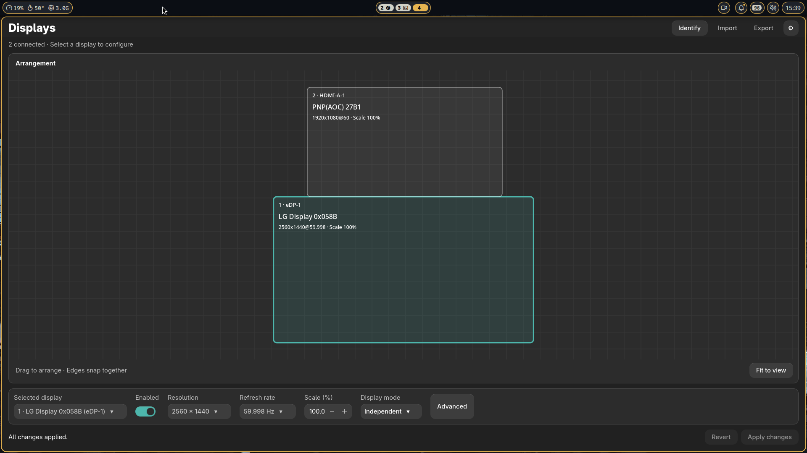

# Niri Displays

A small GTK 4 application for managing displays in a running Niri session.




> [!WARNING]
> This extension was written with the help of a coding agent.

## Run

Requires Python 3.10+, PyGObject, GTK 4, Pycairo with GI Cairo integration, and `niri` on `PATH`. Install `wl-mirror` for mirroring. Run from a terminal inside your Niri session:

```sh
python3 app.py
```

On Fedora, the Python/GTK dependencies are available as:

```sh
sudo dnf install python3-gobject gtk4 python3-cairo
```

Niri and wl-mirror can come from your existing system packages or Nix profile. Use the system Python that provides `gi`; a plain virtual environment will not normally include system PyGObject.

## Optional background daemon

The daemon is **off by default**. Open **Settings → Restore layouts automatically** to enable it. Disable the same option to stop the daemon and turn off its login startup.

Each time you apply a layout and choose **Keep**, the app saves that confirmed layout under `$XDG_CONFIG_HOME/niri-display/layouts` (default `~/.config/niri-display/layouts`). Unconfirmed and reverted changes are not saved. Enabling the daemon also remembers the current layout if no layout exists for those connected outputs. To reuse an older exported configuration, import it and confirm it first.

The daemon restores the last confirmed layout for an exact set of output connector names at startup and when that set changes. It checks connections every two seconds. Unknown monitor combinations stay unchanged. It does not continually enforce settings, so it does not undo ordinary edits. Different monitors using the same connectors share a saved layout. Mirroring is not restored.

If disconnecting external monitors leaves only a disabled built-in display, the daemon turns it on even without a saved layout. Built-in displays are identified by `eDP-`, `LVDS-`, or `DSI-` connector names. This fallback does not enable a lone external display or change an already enabled built-in display.

Enabling creates and starts `niri-display-daemon.service` in your systemd user session. The service keeps running after the app closes. Automatic startup at login requires Niri to manage `graphical-session.target`, such as a session started with `niri --session`. Without that session integration, enabling still starts the daemon now, but login startup is not guaranteed. Re-run the install task before enabling if you run an installed copy.

The daemon can also be controlled from the source directory:

```sh
python3 daemon.py --enable
python3 daemon.py --status
python3 daemon.py --disable
```

Run `python3 daemon.py` in a terminal for foreground operation without enabling a service. View service errors with `journalctl --user -u niri-display-daemon.service`. A failed restore attempts to roll back the previous layout; it does not retry that monitor combination until connections change.


## Mise tasks

Run tests and syntax checks:

```sh
mise run test
```

Install the application for your user, without root access:

```sh
mise run install
niri-display
```

Installation copies the Python files into `$XDG_DATA_HOME/niri-display` (default `~/.local/share/niri-display`) and creates `~/.local/bin/niri-display`. Add `~/.local/bin` to `PATH` if needed. Re-run the install task after changing the source. The task refuses to overwrite an unrelated launcher.

The install task does not install system dependencies. Install the dependencies listed above before launching the application.

## Checks

Run the regression suite and syntax checks:

```sh
python3 -m unittest discover -s tests -v
python3 -m py_compile app.py backend.py services.py daemon.py
```

The 15 unit tests cover layout safety, configuration boundaries, and fractional-scale canvas geometry, including rotated outputs. The geometry check requires the application's GTK dependencies but does not open a window.
