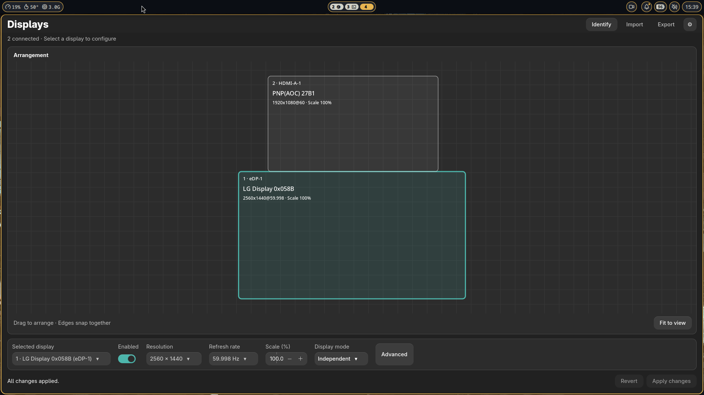

# Niri Displays

A small Rust and GTK 4 application for managing displays in a running Niri session.



> [!WARNING]
> This application was written with the help of a coding agent.

## Build and run

Requires Rust and Cargo, GTK 4.12 or newer with development files, and `niri` on `PATH`. Install `wl-mirror` for mirroring.

On Fedora:

```sh
sudo dnf install rust cargo gcc pkgconf-pkg-config gtk4-devel
```

Build and run inside your Niri session:

```sh
cargo build --release --locked
./target/release/niri-display
```

On Debian or Ubuntu, install `build-essential`, `pkg-config`, and `libgtk-4-dev` alongside Rust and Cargo. The distribution must provide GTK 4.12 or newer.

The application is a native Rust binary; Python and PyGObject are no longer required. GTK and its runtime libraries remain system dependencies.

Niri and wl-mirror can come from system packages or a Nix profile. On non-NixOS systems, install `nixGL` if `wl-mirror` comes from Nix; the app launches that Nix-store binary through `nixGL` when available.

## Editing displays

Select a display in the arrangement preview or the dock. Drag to arrange displays; nearby edges snap together. Arrow keys move the selected display by one logical pixel, or ten with Shift. Page Up and Page Down select another display. Scroll to zoom; **Fit to view** resets zoom.

The dock controls enabled state, resolution, refresh rate, and scale. **Advanced** exposes logical position and custom resolution controls. **Identify** briefly labels connected screens. **Import** and **Export** read and write layout JSON.

Changes remain staged until **Apply changes**. Choose **Keep changes** within 20 seconds or the previous layout is restored. Closing the confirmation or pressing Escape also restores the previous layout. At least one display must stay enabled. Failed applies attempt to restore the previous layout.

Mirroring starts immediately, independently of staged display changes. Settings choose whether the selected display is the source or destination. Stop mirroring before disabling either display. Closing the editor stops its mirror process.

## Profiles

Open **Profiles** in the editor. Enter a new name and choose **Save current edits** to save monitor settings, including unapplied edits and active mirrors. Existing names cannot be overwritten; delete a named profile before reusing its name.

Select a named or predefined profile and choose **Apply profile** to switch layouts with the editor's 20-second confirmation. **Delete** is available only for named profiles and asks for confirmation.

### Predefined profiles

Open **Settings → Predefined profiles** to configure:

- **Build-in**: enables built-in displays and disables every connected external display. Works without an external display.
- **External**: disables built-in displays and enables every connected external display, arranged side by side.
- **Mirror build-in**: mirrors the built-in display to every connected external display. Requires `wl-mirror`.
- **Horizontal**: enables built-in and external displays side by side, with the built-in group on the left or right.
- **Vertical**: enables built-in and external displays in a vertical stack, with the built-in group above or below.

### Compact picker

Launch the compact profile picker:

```sh
./target/release/niri-display --profiles
# After installation:
niri-display --profiles
```

Press **1–9** to apply the corresponding numbered profile immediately and close the picker. Number-pad digits also work. Alternatively, use arrow keys and Enter, or click a profile. Profiles after the ninth remain accessible through clicking or arrow keys. This mode does not ask for confirmation or automatically revert successful changes. Failed applies attempt to restore the previous layout; if restoring fails, **Retry restore** remains available.

Escape closes the picker without switching. If a switch is already running, it finishes before the picker closes. Press **E** to open the full editor and close the picker.

Drag anywhere on a profile row onto the upper or lower half of another row to place it before or after that profile. One shared line marks the insertion boundary between rows. Named profiles and visible presets share persistent ordering and shortcuts. The order also applies to the editor's profile list; hiding a preset preserves its saved position. Newly created profiles appear after the saved order.

The picker fits its height to the list, scrolling when the list exceeds 420 pixels. It defaults to Cairo rendering to avoid GPU initialization overhead. An explicit `GSK_RENDERER` takes precedence. Opening the editor preserves the original renderer environment.

Profiles live under `$XDG_CONFIG_HOME/niri-display/profiles` (default `~/.config/niri-display/profiles`), separately from automatic daemon layouts. Named profiles store connector names, enabled state, mode, scale, position, rotation, and active mirrors. All monitors saved in a named current-settings profile must be connected before applying it. Additional connected monitors keep their current settings. Preset settings and visibility are stored in `.predefined.json`, and shared ordering in `.order.json`. Existing layout-list, single-mirror, and previously saved dynamic profiles remain readable.

## Optional background daemon

The daemon is **off by default**. Open **Settings → Restore layouts automatically** to enable it. Disable the same option to stop the daemon and turn off login startup.

Each confirmed editor layout and successful picker switch is saved under `$XDG_CONFIG_HOME/niri-display/layouts` (default `~/.config/niri-display/layouts`). Unconfirmed and reverted changes are not saved. Enabling the daemon also remembers the current layout if no layout exists for those connected outputs.

The daemon restores the last confirmed layout for an exact set of connector names at startup and when that set changes. It checks connections every two seconds. Unknown combinations stay unchanged. It does not continually enforce settings, so ordinary edits are not undone. Different monitors using the same connectors share a saved layout. Mirroring is not restored.

If disconnecting external monitors leaves only a disabled built-in display, the daemon turns it on even without a saved layout. Built-in displays use `eDP-`, `LVDS-`, or `DSI-` connector names. This fallback does not enable a lone external display or change an already enabled built-in display.

Enabling creates and starts `niri-display-daemon.service` in the systemd user session. The service starts with `default.target`; it does not require `niri --session` or `graphical-session.target`. It keeps running after the app closes and waits for Niri. With user lingering, it may also run outside a graphical session.

```sh
niri-display --daemon --enable
niri-display --daemon --status
niri-display --daemon --disable
```

Run `niri-display --daemon` for foreground operation without enabling a service. From source, substitute `./target/release/niri-display`. View errors with `journalctl --user -u niri-display-daemon.service`. A failed restore attempts rollback and does not retry that monitor combination until connections change.

### Upgrading from Python

Existing profiles, their order, exported JSON, and automatic layout files remain compatible. No data conversion is required.

Re-run `mise run install`, then run `niri-display --daemon --enable` if automatic restore was enabled. This rewrites the existing service to launch the Rust binary and migrates its startup links. Enabling from an uninstalled build binds the service to that build's absolute executable path; install first for a stable service path.

The Python entrypoints have been removed. Use the binary for the editor, picker, and daemon.

## Mise tasks

```sh
mise run test
mise run build
mise run install
niri-display
```

Installation builds a release binary in `$XDG_DATA_HOME/niri-display` (default `~/.local/share/niri-display`) and links `~/.local/bin/niri-display` to it. Add `~/.local/bin` to `PATH` if needed. Re-run installation after source changes. The task migrates this project's former Python launcher but refuses to overwrite unrelated launchers. Installation does not install system dependencies.

## Checks

Install the `rustfmt` and `clippy` packages on Fedora for formatting and lint checks, or add those components with Rustup.

```sh
cargo test --locked
cargo clippy --all-targets --locked -- -D warnings
cargo fmt --check
```

Regression tests cover safe compositor mutation order, strict configuration boundaries, legacy profile and layout compatibility, port-independent profile resolution, saved per-role settings, preset visibility and ordering, daemon connector transitions, and fractional-scale geometry. Tests run compositor commands against an isolated executable and do not change the running desktop.

## Desktop diagnostics

If GTK reports `Unable to connect to the accessibility bus` with `Connection refused`, restart the user accessibility service:

```sh
systemctl --user restart at-spi-dbus-bus.service
```

GTK `Theme parser error` messages identify invalid CSS in the desktop theme, not the display layout. Check the indicated line in `~/.config/gtk-4.0/gtk.css` or the active theme. A selector ending with `>` immediately before a comma is incomplete. Theme changes affect other GTK applications too.

`MESA-INTEL` diagnostics come from the graphics driver. They do not by themselves mean a profile failed to apply; application errors appear in the picker or editor.
